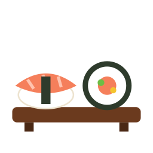
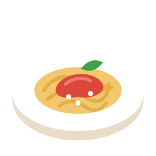
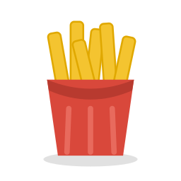
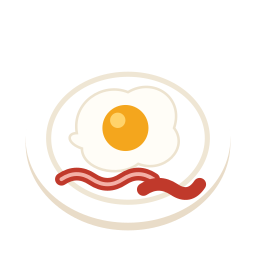
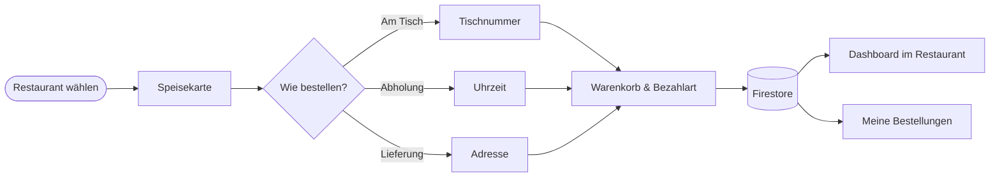
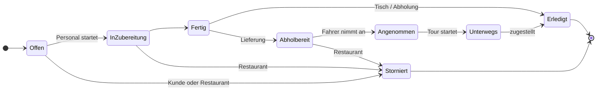
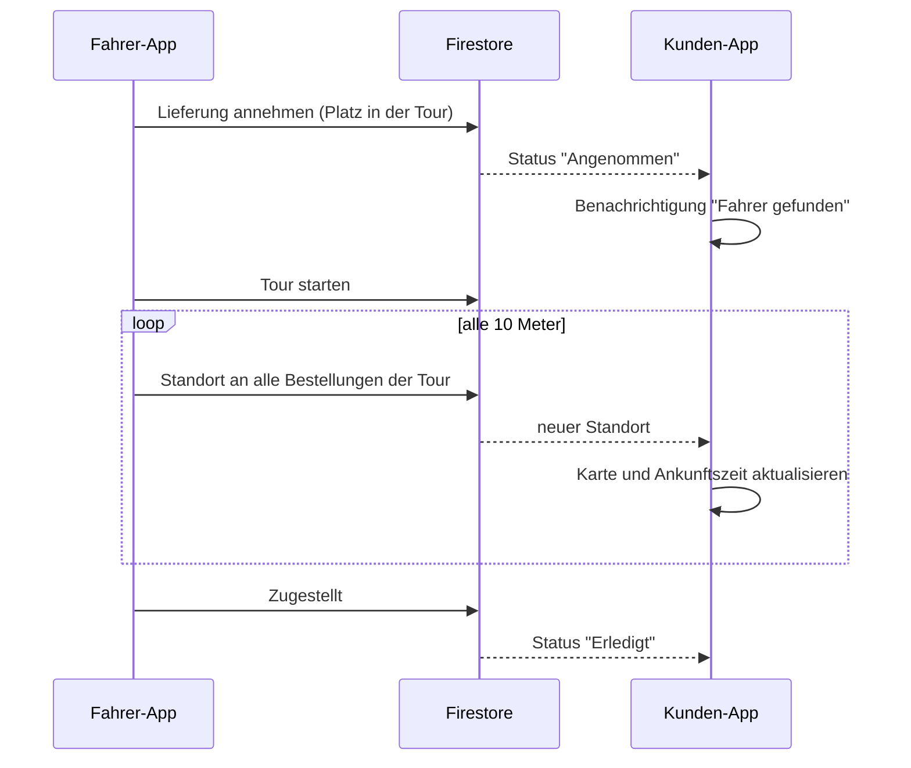
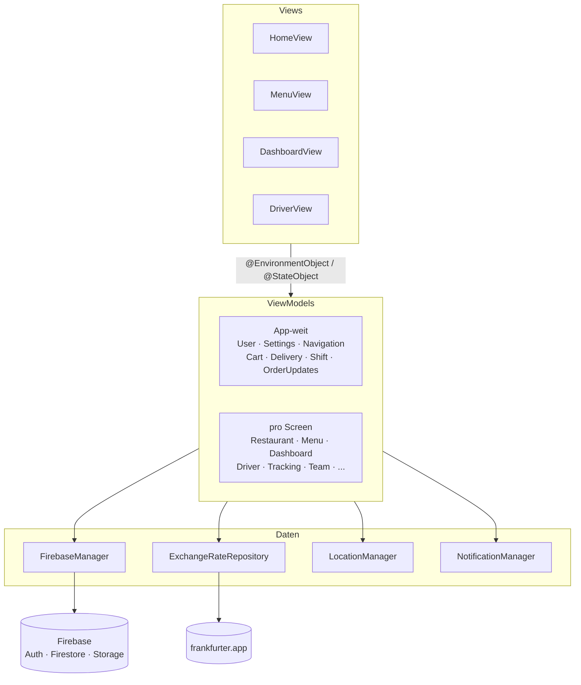
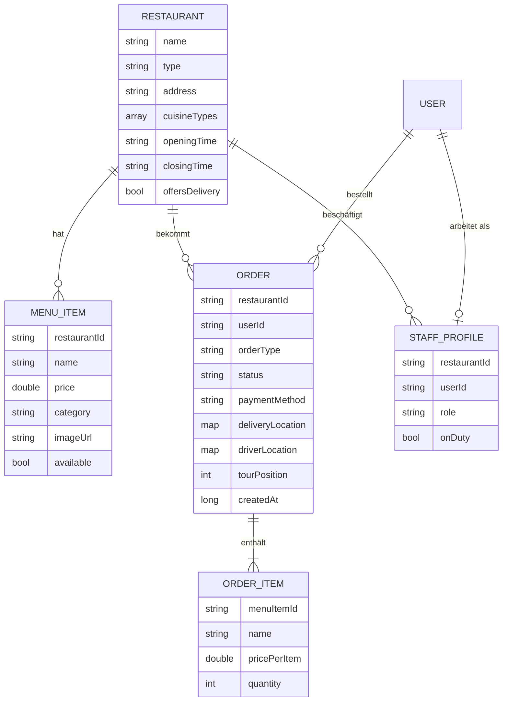

<div align="center">


# Tableo

**Bestellen am Tisch, zum Abholen oder per Lieferung. Für Restaurants, Cafés und Shisha-Bars.**

Native iOS-App in Swift und SwiftUI mit Firebase als Backend.
Gäste bestellen, das Personal arbeitet die Bestellungen live ab und Fahrer liefern mit Live-Tracking aus.

<br />


<br />

&nbsp;
&nbsp;
&nbsp;
&nbsp;
&nbsp;
&nbsp;
&nbsp;
&nbsp;
&nbsp;
&nbsp;


</div>

---

## Inhalt

- [Über das Projekt](#über-das-projekt)
- [Funktionen](#funktionen)
- [So läuft eine Bestellung](#so-läuft-eine-bestellung)
- [Live-Tracking](#live-tracking)
- [Architektur](#architektur)
- [Datenmodell](#datenmodell)
- [Projektstruktur](#projektstruktur)
- [Technologien](#technologien)
- [Sprachen](#sprachen)
- [Installation](#installation)
- [Autor](#autor)

---

## Über das Projekt

Tableo ersetzt die Papierkarte und den Zettelblock. Gäste sehen die Speisekarte auf dem eigenen Handy,
bestellen direkt an den Tisch, holen später ab oder lassen sich liefern. Die Küche sieht neue Bestellungen
sofort im Dashboard, und bei Lieferungen verfolgt der Kunde den Fahrer live auf der Karte.

Die App ist die native iOS-Version von Tableo. Daneben gibt es eine
[Kotlin-Multiplatform-Version](https://github.com/Ali-C313/Tableo-KMP) für Android.
Beide nutzen dasselbe Firebase-Projekt und arbeiten mit denselben Daten:
Eine Bestellung vom iPhone erscheint sofort im Dashboard auf dem Android-Tablet und umgekehrt.

---

## Funktionen

Eine App, drei Rollen. Welche Bereiche man sieht, hängt vom Konto ab.

<table>
<tr>
<th width="33%">Gäste &amp; Kunden</th>
<th width="33%">Personal</th>
<th width="33%">Fahrer</th>
</tr>
<tr valign="top">
<td>

- Restaurants nach Küche, Art und Name filtern
- Geöffnete Restaurants zuerst
- Abholung oder Lieferung umschalten
- Lieferadresse per Standort oder Suche
- Speisekarte mit Preisen in EUR, USD, GBP und TRY
- Am Tisch, zur Abholzeit oder als Lieferung bestellen
- Bestellen auch ohne Konto als Gast
- Status jeder Bestellung live
- Benachrichtigung bei jedem neuen Schritt
- Erneut bestellen mit einem Tipp
- Stornieren, solange noch nicht gekocht wird

</td>
<td>

- Dashboard mit allen offenen Bestellungen
- Status von Neu über In Zubereitung bis Fertig
- Dienst-Schalter mit Benachrichtigung bei neuen Bestellungen
- Speisekarte verwalten, mit Foto-Upload
- Artikel als ausverkauft markieren
- Team mit Rollen (Leitung, Kellner, Koch, Küchenhilfe, Bar, Lieferant)
- Archiv aller abgeschlossenen Bestellungen
- Statistik: Umsatz und Bestellungen für 24 Std., 3 Tage, 1 Monat oder 6 Monate

</td>
<td>

- Abholbereite Lieferungen annehmen
- Eigene Tour planen und umsortieren
- Tour starten, Standort wird live geteilt
- Navigation mit Apple Karten
- Zustellung bestätigen, die nächste rückt nach
- Benachrichtigung bei neuen Lieferungen

</td>
</tr>
</table>

**Außerdem:** Hell- und Dunkelmodus, 10 Sprachen ohne Neustart umschaltbar, Arabisch von rechts nach links,
Profilbild, Konto löschen mit 30 Tagen Bedenkzeit, Impressum, Datenschutz und AGB in der App.

---

## So läuft eine Bestellung



Jede Bestellung durchläuft feste Schritte. Am Tisch und bei Abholung endet sie in der Küche,
eine Lieferung geht danach an die Fahrer:



Das Stornieren läuft über eine Firestore-Transaktion. So kann eine Bestellung nicht gleichzeitig
storniert und vom Fahrer angenommen werden.

---

## Live-Tracking

Sobald ein Fahrer eine Lieferung annimmt, schickt die App seinen Standort an alle Bestellungen seiner Tour.
Der Kunde sieht den Fahrer auf der Karte und eine geschätzte Ankunftszeit. Darin sind auch die
Lieferungen eingerechnet, die der Fahrer vorher noch macht.



Die Ankunftszeit rechnet mit rund 25 km/h in der Stadt und 3 Minuten pro Übergabe an der Tür.
Die Strecke geht über alle Stopps, die vorher noch dran sind.

---

## Architektur

Die App ist nach **MVVM** aufgebaut. Views zeigen nur an, ViewModels halten den Zustand und sprechen mit Firebase.



- **ViewModels** sind `ObservableObject`-Klassen mit `@Published`-Variablen und laufen auf dem `@MainActor`.
- **Live-Daten** kommen über Firestore-Snapshot-Listener. Eine View startet den Listener in `onAppear`
  und beendet ihn in `onDisappear`.
- **App-weite ViewModels** werden einmal in `TableoApp` erstellt und mit `environmentObject` weitergegeben,
  z.B. der Warenkorb, der über mehrere Screens erhalten bleibt.
- **Navigation:** Jeder Tab hat einen eigenen `NavigationStack`, alle Ziele sind im Enum `Route` beschrieben.
- **Wechselkurse** kommen über ein Repository mit Protocol, das mit `URLSession` und `Codable` arbeitet.

---

## Datenmodell



| Collection      | Inhalt                                                   |
|-----------------|----------------------------------------------------------|
| `restaurants`   | Restaurants mit Öffnungszeiten und Küchen                |
| `menuItems`     | Artikel der Speisekarte, gehören zu einem Restaurant     |
| `orders`        | Bestellungen mit Positionen, Status und Fahrer-Standort  |
| `staffProfiles` | Mitarbeiter, die Dokument-ID ist die User-ID             |
| `users`         | Vormerkung zum Löschen eines Kontos                      |

---

## Projektstruktur

```
Tableo/
├── TableoApp.swift          Start der App, Firebase und die ViewModels für die ganze App
├── Enums/                   OrderStatus, OrderType, Route, StaffRole, ThemeMode ...
├── Models/                  FireRestaurant, FireMenuItem, FireOrder, FireStaffProfile ...
├── ViewModels/              ein ViewModel pro Bereich
├── Views/
│   ├── Start/               Splash und Onboarding
│   ├── Main/                RootView, Tabs und Navigation
│   ├── Home/                Startseite mit allen Restaurants
│   ├── Menu/                Speisekarte
│   ├── Order/               Bestelldetails, Warenkorb, Bestätigung
│   ├── MyOrders/            Meine Bestellungen, Details, Live-Tracking
│   ├── Auth/                Anmelden und Registrieren
│   ├── Settings/            Konto, Kontoinformationen, Rechtliches
│   ├── Staff/               Dashboard, Archiv, Speisekarte, Team, Statistik
│   ├── Driver/              Fahrer-Bereich
│   └── Components/          kleine Views für mehrere Screens
├── Repositories/            Wechselkurs-API
├── Utils/                   FirebaseManager, Standort, Benachrichtigungen, Formatierung
├── Theme/                   Farben, Schriften, Button-Stile
├── Assets.xcassets          App-Icon, Logo, Bilder der Küchen
└── Resources/               String Catalog, Schriften, Info.plist
```

---

## Technologien

| Bereich              | Umsetzung                                                    |
|----------------------|--------------------------------------------------------------|
| Sprache & UI         | Swift 5, SwiftUI                                             |
| Architektur          | MVVM mit `ObservableObject`, `@Published`, `@EnvironmentObject` |
| Anmeldung            | Firebase Auth (E-Mail, anonym für Gäste)                     |
| Datenbank            | Cloud Firestore mit Snapshot-Listenern, Transaktionen, Batches |
| Bilder               | Firebase Storage, `AsyncImage`, `PhotosPicker`               |
| Karte & Standort     | MapKit, CoreLocation, CLGeocoder                             |
| Benachrichtigungen   | UserNotifications                                            |
| Netzwerk             | `URLSession`, `Codable`, Wechselkurse von frankfurter.app    |
| Übersetzungen        | String Catalog (`Localizable.xcstrings`)                     |
| Design               | eigene Farben für Hell und Dunkel, Fraunces und Manrope als Schriften |

---

## Sprachen

Die Sprache lässt sich in der App unter **Konto > Einstellungen** ohne Neustart umstellen.

| | | | | |
|:-:|:-:|:-:|:-:|:-:|
| Deutsch | English | Türkçe | العربية | Español |
| Français | Italiano | Polski | Русский | Українська |

Die Texte stehen auf Deutsch im Code, die Übersetzungen im String Catalog.
Bei Arabisch dreht sich die ganze Oberfläche auf rechts nach links.

---

## Installation

**Voraussetzungen:** Xcode 16 oder neuer, iOS 18.2 oder neuer, ein Firebase-Projekt.

1. Repository klonen
   ```bash
   git clone https://github.com/Ali-C313/Tableo-IOS.git
   ```
2. In der [Firebase Console](https://console.firebase.google.com) eine iOS-App anlegen,
   die `GoogleService-Info.plist` herunterladen und nach `Tableo/Resources` legen.
   Die Datei ist bewusst nicht im Repository.
3. In Firebase **Authentication** (E-Mail/Passwort und Anonym), **Firestore** und **Storage** aktivieren.
4. `Tableo.xcodeproj` öffnen. Xcode lädt das Firebase-Paket beim ersten Öffnen selbst.
5. Unter *Signing & Capabilities* das eigene Team wählen, die Bundle-ID steht in `Configuration/Config.xcconfig`.
6. Simulator oder iPhone wählen und starten.

---

## Autor

**Ali Chehab**

[](https://github.com/Ali-C313)

Entstanden als Abschlussprojekt im Syntax Institut.
